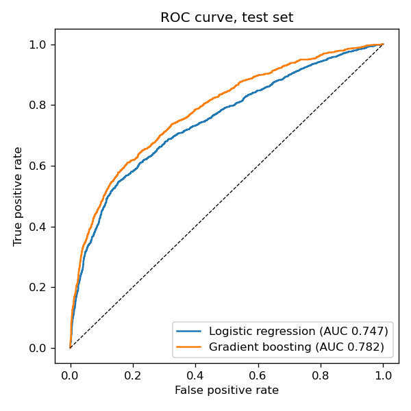
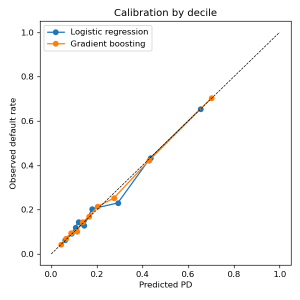
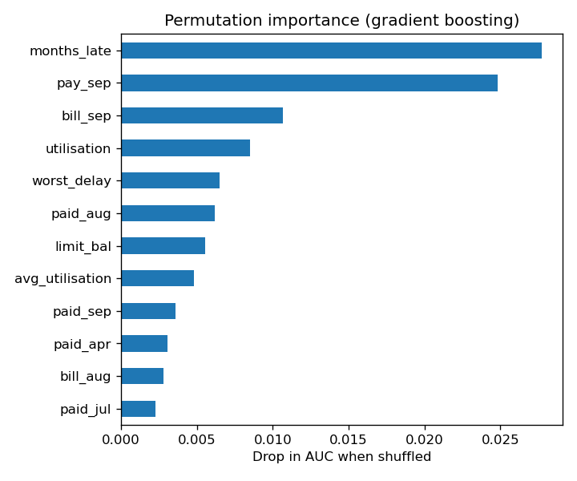
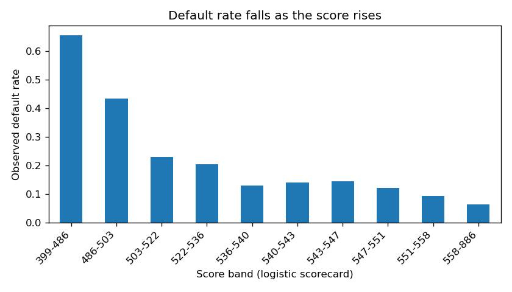

# Credit card default model

A probability-of-default (PD) model for 30,000 credit card clients, built in Python with scikit-learn. I compare a logistic regression scorecard with a gradient boosting model, check how well each one is calibrated, and pick an approval cutoff by putting a price on each kind of mistake.

## Data

The [UCI Default of Credit Card Clients](https://archive.ics.uci.edu/dataset/350/default+of+credit+card+clients) dataset (Yeh and Lien, 2009) covers clients of a Taiwanese bank between April and September 2005. Each row has the credit limit, age, sex, education, marital status, six months of repayment status, bill amounts and payments, and whether the client defaulted the following month. 22.1% of clients defaulted.

The script downloads the data from OpenML (dataset 42477) on the first run, so nothing is stored in this repo.

Two cleaning steps: education codes 0, 5 and 6 are not documented in the source, so I merged them into "other", and marriage code 0 went into "other" for the same reason.

## Features

On top of the raw columns I added five that a credit analyst would look at first:

| Feature | Meaning |
|---|---|
| `utilisation` | September bill divided by the credit limit |
| `avg_utilisation` | Average bill over six months divided by the limit |
| `months_late` | Number of months, out of six, with a payment delay |
| `worst_delay` | Longest delay in the period, in months |
| `repay_ratio` | Average share of each bill repaid the next month, capped at 100% |

## Method

1. Stratified 80/20 train/test split (24,000 train, 6,000 test), same default rate in both.
2. Logistic regression on standardised features. This is the transparent baseline, and its PD converts directly into scorecard points.
3. Histogram gradient boosting (scikit-learn), with early stopping and L2 regularisation.
4. On the test set: AUC, Gini, KS and Brier score, plus a calibration curve by decile.
5. Cutoff choice. I assumed that approving a client who then defaults costs five times as much as turning away a client who would have paid. The 5:1 ratio is my assumption, not something in the data, and it sits in one constant at the top of `credit_model.py` if you want to change it. The script then searches PD cutoffs from 5% to 95% and keeps the one with the lowest total cost.
6. Scorecard. Logistic PDs become scores with the usual points-to-double-the-odds scaling: 600 points at 50:1 odds of repaying, and every 20 points doubles the odds.

## Results (test set, 6,000 clients)

| Model | AUC | Gini | KS | Brier | Cost-based PD cutoff | Clients flagged | Defaults caught |
|---|---|---|---|---|---|---|---|
| Logistic regression | 0.747 | 0.494 | 0.393 | 0.142 | 0.15 | 41.5% | 69.9% |
| Gradient boosting | 0.782 | 0.564 | 0.428 | 0.135 | 0.17 | 43.1% | 74.3% |

Gradient boosting ranks clients better (Gini up 7 points) and its total misclassification cost at the chosen cutoff is about 7% lower (3,302 against 3,565 cost units). Both models are well calibrated: predicted PDs sit close to observed default rates in every decile.

The cutoffs are low (15 to 17% PD) and flag over 40% of clients. That follows from the 5:1 cost ratio. When a missed default is that expensive, it pays to refer a lot of borderline clients for review. A lower ratio, say 2:1, would push the cutoff up and flag fewer clients.




Repayment history matters most. Shuffling `months_late` or the September repayment status costs the model more AUC than any other column, followed by the size of the latest bill and utilisation:



In the scorecard, the bottom score decile defaults at about 65% and the top decile at about 6%. The middle deciles are close together (12 to 15%), so the scorecard is strong at the extremes and weaker at separating average clients:



Full numbers, including importances, are in `reports/metrics.json`.

## Limitations

The data is from one Taiwanese bank in 2005, so the model shows the method, not a PD that could be used on today's UK customers. The split is random rather than out of time, because the dataset only covers one six-month window. Sex, age and marital status are in the model because they are in the data, but a real lender in the UK could not use sex or marital status in a credit decision, and those columns would have to come out.

## Run it

```
pip install -r requirements.txt
python credit_model.py
python -m pytest
```

`credit_model.py` holds the whole pipeline (data, features, models, metrics, charts). `test_credit_model.py` checks the feature logic, the KS and cutoff functions, and the score scaling.

## Reference

Yeh, I. C., and Lien, C. H. (2009). The comparisons of data mining techniques for the predictive accuracy of probability of default of credit card clients. Expert Systems with Applications, 36(2), 2473-2480.
